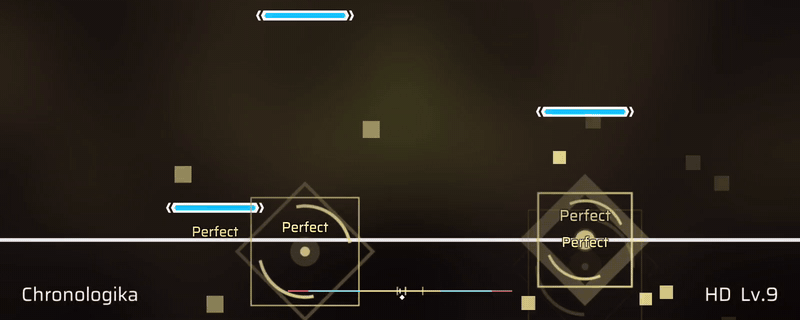

# Hit bursts

A mod for [Phigros++](https://github.com/ggmolly/PhigrosPlusPlus) that pops the judgement of each note where it is judged: Perfect, Good, Bad or Miss, in the game's own colours. A hit pops in over a tenth of a second and fades out half a second later, and a miss tilts and falls, the way osu!'s classic judgements move.

## Install

Open the **Mods** tab of the game's settings and pick Hit bursts in the catalog, or open [this link](phigrospp://install/ggmolly/phigrospp-hit-bursts) on the device.

## Settings

The mod adds a **Hit bursts** tab to the settings. Its last row plays the four bursts over and over, as the style and the size picked make them.

| Setting | |
|---|---|
| Show hit bursts | Turns them all off without disabling the mod |
| Style | `Phigros` for the game's words in its colours, `osu!` for 300, 100, 50 and a cross |
| Show them on perfect hits | Off leaves only what went wrong on screen |
| Show them on drags and flicks | Off by default, a stream of drags fills the screen with them. A missed one always shows |
| Size | From half to twice their size |

## How it works

Phigros++ tells mods where each hit lands on screen (`hit.x` and `hit.y` in `on("hit")`), so the mod only draws: a pool of texts on a canvas over the game, moved and faded every frame. The animation is the one of osu!'s `LegacyJudgementPieceOld`.

It needs a Phigros++ newer than 0.1.0-beta.12, for where hits land and for the preview row of its settings.
