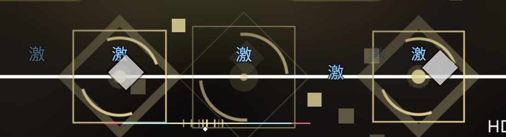

# Hit bursts

A mod for [Phigros++](https://github.com/ggmolly/PhigrosPlusPlus) that pops a small score where each note is judged, the way osu! does: 300 for a perfect, 100 for a good, 50 for a bad and a falling cross for a miss. Each one follows the timing of osu!'s classic judgements, popping in over a tenth of a second and fading out half a second later.

## Install

Open the **Mods** tab of the game's settings and pick Hit bursts in the catalog, or open [this link](phigrospp://install/ggmolly/phigrospp-hit-bursts) on the device.

## Settings

The mod adds a **Hit bursts** tab to the settings.

| Setting | |
|---|---|
| Show hit bursts | Turns them all off without disabling the mod |
| Style | `osu!` for 300, 100 and 50, `kanji` for 激 on a perfect and 喝 on a good |
| Show them on perfect hits | Off leaves only what went wrong on screen |
| Show them on drags and flicks | Off by default, a stream of drags fills the screen with 300s |
| Size | From half to twice their size |

## How it works

Phigros++ tells mods where each hit lands on screen (`hit.x` and `hit.y` in `on("hit")`), so the mod only draws: a pool of texts on a canvas over the game, moved and faded every frame. The animation is the one of osu!'s `LegacyJudgementPieceOld`.

It needs a Phigros++ newer than 0.1.0-beta.12.
